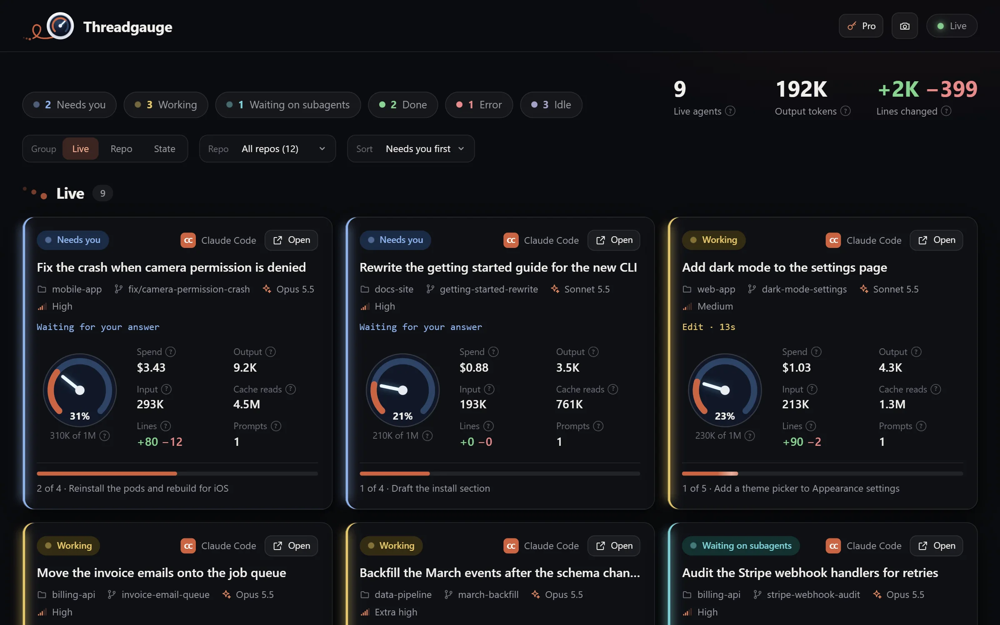
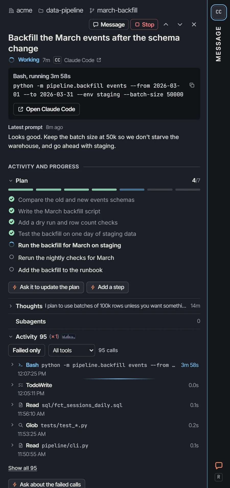

<p align="center">
  
</p>

<h1 align="center">Threadgauge</h1>

<p align="center">
  <strong>Live telemetry for your coding agents.</strong>
</p>

<p align="center">
  <a href="https://threadgauge.io">threadgauge.io</a> ·
  <a href="#release">Release</a> ·
  <a href="docs/">Docs</a> ·
  <a href="https://github.com/threadcrumbs/threadgauge-community/issues">Issues</a> ·
  <a href="https://github.com/threadcrumbs/threadgauge-community/discussions">Discussions</a>
</p>



Threadgauge is a live dashboard of every coding-agent thread on your computer. For each one, it
shows the tool it's running, how full its context window is, what it has cost, how much code it
has changed, and how far through its plan it is.

> **About this repo.** Threadgauge is free to use and closed source. This repo is where you report
> bugs, ask for features and harnesses, and read the docs. The app's source code isn't here.

## Release

**Threadgauge isn't released yet.** To hear when it is, choose **Watch → Custom → Releases** at
the top of this repo. On launch day, this starts it:

```bash
npx @threadcrumbs/threadgauge
```

It'll need [Node.js](https://nodejs.org) 22.13 or newer, on macOS, Windows, or Linux.

## Works with

| Harness | What it shows |
| --- | --- |
| **[Claude Code](https://claude.com/claude-code)** | Everything: status, current tool, context, tokens, spend, lines changed, plan, and subagents |
| **[Codex](https://developers.openai.com/codex/cli)** | Everything but spend, which Codex doesn't save |
| **[OpenCode](https://opencode.ai)**, **[Kilo Code](https://kilocode.ai)** | Everything. OpenCode 2.x doesn't record lines |
| **[Hermes](https://github.com/NousResearch/hermes-agent)** | Everything but lines |
| **[Cursor](https://cursor.com)** | Status, the tool it last called, plan, and subagents. Cursor saves no tokens, context, or spend |
| **[Antigravity CLI](https://antigravity.google)** | Status and plan |

Where a harness doesn't record something, the card shows "—" instead of a guess. More in
[docs/harnesses.md](docs/harnesses.md). Using another harness?
[Ask for it](https://github.com/threadcrumbs/threadgauge-community/issues/new?template=harness.yml).

## Every thread's whole story

Free, Threadgauge is the whole live dashboard: every card, the totals, grouping and filters, and
an Open button that takes you back to any thread in its own harness. **Threadgauge Pro** adds each
thread's details beside it: what filled its context, its context over time, its plan, every tool
call, its subagents, the files it changed, its prompts, and its errors. Prices are at
[threadgauge.io/pro](https://threadgauge.io/pro).



## It stays on your computer

- **It only reads.** Threadgauge reads each harness's own files on your computer, and it never
  writes to a harness.
- **Nothing to sign up for.** There's no account and no sign-in, and Threadgauge reports nothing
  back to us.
- **Your work stays put.** Your threads, code, and project names never leave your computer.
- **Pro sends one thing.** Threadgauge Pro sends its license key and a random ID for your
  computer, to activate and renew the license.

The details are in [docs/privacy.md](docs/privacy.md).

## Help and feedback

| | |
| --- | --- |
| Something's broken | [Report a bug](https://github.com/threadcrumbs/threadgauge-community/issues/new?template=bug.yml) |
| Your harness isn't supported | [Ask for a harness](https://github.com/threadcrumbs/threadgauge-community/issues/new?template=harness.yml) |
| You have an idea | [Suggest a feature](https://github.com/threadcrumbs/threadgauge-community/issues/new?template=feature.yml) |
| You have a question | [Ask in Discussions](https://github.com/threadcrumbs/threadgauge-community/discussions/categories/q-a) |
| You found a security problem | Don't file it publicly. See [SECURITY.md](SECURITY.md) |
| Anything else | [hello@threadcrumbs.io](mailto:hello@threadcrumbs.io) |

## Also from Threadcrumbs

**[Threadnauts](https://threadnauts.io)** shows the same threads as little bots in a 3D colony,
one zone for each repo, and it's out now. When both are running, each one links to the other, and a
bot's card shows its thread's context from Threadgauge.

## License

The docs, forms, and pictures in this repo are under [CC BY 4.0](LICENSE): share and adapt them,
with credit to Threadcrumbs LLC. Threadgauge itself isn't in this repo. It will be free to use
under its own license, which ships with the app. The names Threadgauge, Threadnauts, and
Threadcrumbs, their logos, and Baut aren't licensed for reuse, except to refer to the apps.

## Credits

Threadgauge is made by [Threadcrumbs LLC](https://threadcrumbs.io).

Not affiliated with Anthropic, OpenAI, Google, or any of the other harness vendors named here.
